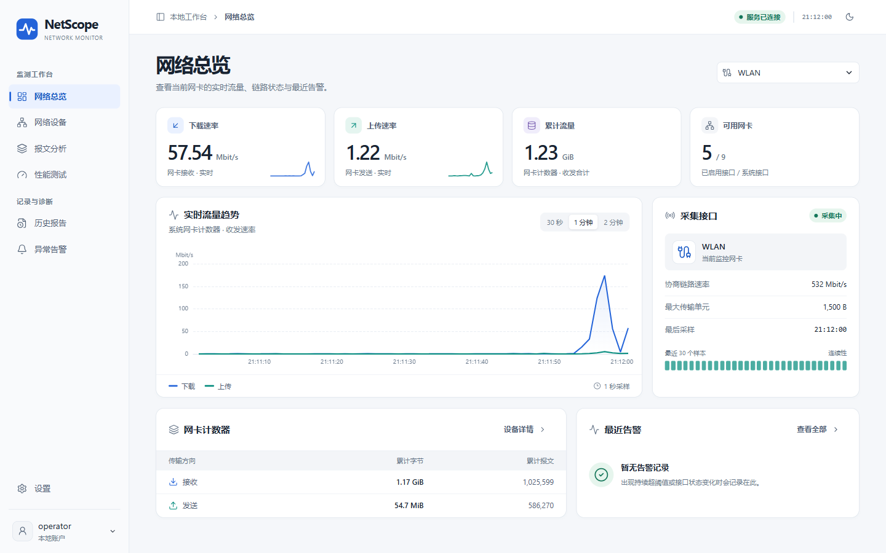

# NetScope

NetScope 是一款运行在 Windows 本机的网络性能监测工作台。打开浏览器即可查看网卡的收发速率、检查 TCP/IP 报文首部，并测量到另一台受控设备的双向吞吐量。

总览曲线来自系统网卡计数器。报文分析页有独立的抓包会话，性能测试页有独立的配对端点，三种数据各自标明来源与单位。

| 工作区 | 可执行的操作 |
| --- | --- |
| 网络总览与设备 | 切换接口，观察秒级速率、累计报文与链路状态；查看操作系统已学习的邻居和当前套接字。 |
| 报文分析 | 在授权接口启动或停止抓包，或导入经典 PCAP；按 IP、协议、端口过滤并展开首部。 |
| 性能测试 | 对配对的 NetScope 端点测试 HTTP 往返时间、上传和下载吞吐量，记录测量范围。 |
| 历史与告警 | 按网卡、时间段查分钟流量，导出 CSV；查看协议和端点汇总、确认告警、调整恢复条件。 |

## Windows 快速启动

需要 Windows 10/11、Git、Node.js 22.12+ 或 24 LTS，以及 uv。uv 可安装 Python 3.12。实时抓包还需要 Npcap，缺少驱动时仍可使用计数器、测速和 PCAP 导入。[uv 安装说明](https://docs.astral.sh/uv/getting-started/installation/) · [Node.js](https://nodejs.org/en/download) · [Npcap](https://npcap.com/#download)

在 PowerShell 中运行以下命令。

~~~powershell
git clone https://github.com/SynapseOperator/netscope.git
cd netscope
uv sync --frozen --no-dev --python 3.12
npm.cmd --prefix frontend ci
npm.cmd --prefix frontend run build
.\.venv\Scripts\python.exe -m netscope
~~~

打开 [本机工作台](http://127.0.0.1:8765)，创建本地账户后选择要观察的网卡。再次启动只需最后一行。也可从项目根目录运行 `.\scripts\start.ps1` 完成依赖同步、构建和启动。按 Ctrl+C 正常停止，程序会提交尚未写入的分钟统计。

## 现场演示

**观察接口。** 在“网络设备”里选中已连接的 WLAN 或以太网。切回总览，在该接口上传输文件或执行测速。首个采样点显示等待，取得第二个连续读数后开始绘制速率。邻居页读取 Windows 的 `Get-NetNeighbor` 缓存，覆盖范围随本机最近通信和缓存过期而变化。

**检查报文。** 安装 Npcap 后重启 NetScope。在“报文分析”里选择接口并开始抓包，产生流量，点开一条记录检查 IPv4/IPv6 和 TCP/UDP 首部。停止后可在历史报告中查询协议及端点汇总。演示场地不允许抓包时，可使用附带的样本生成器。[抓包实验与样本说明](docs/capture.md)

**测试另一台电脑。** 在你控制的目标机上使用 Python 3.12 启动独立端点。下面的命令只需要仓库中的 `peer.py` 文件。将示例地址替换为目标机实际分配的测试网卡地址。

~~~powershell
python netscope/peer.py --bind 192.0.2.10 --port 8766
~~~

在 Windows 工作台的“性能测试”中填写 `http://目标机IP:8766` 和端点终端显示的配对密钥。测试端口需要在两台机器之间可达。每次测试先做五次 HTTP 请求，再分别下载、上传 4 MiB。结果使用十进制 Mbit/s。回环、私有地址和公网地址按实际连接对端标注，VPN、代理或反向代理会影响这一解释。公网端点和域名目标需要通过配置了有效证书的 HTTPS 反向代理访问。端点同时处理最多两个连接，单连接限时 15 秒。测试结束后按 Ctrl+C 关闭端点。

## 数据与权限

服务默认仅监听 `127.0.0.1:8765`。本机账户共享这台机器的监测数据、网卡选择及告警规则。密码使用 Argon2id 加盐哈希，浏览器以 HttpOnly 会话 Cookie 登录。工作台适合由可信本机使用者操作。独立测速端点只提供固定长度的测量请求。

默认数据库位于 `data/netscope.sqlite3`，可通过 `NETSCOPE_DB` 指定其他位置。分钟统计、操作日志和已恢复的旧告警按 30 天清理。保存最近 100 次抓包会话汇总和 500 次测速结果。协议端点地址会出现在本机数据库中。每次抓包仅在内存保留最近 500 条首部详情，原始载荷随解析释放。真实 PCAP、数据库和本地凭据已加入 Git 忽略规则。请仅监测自己拥有或已获授权的网络。

## 开发与测试

前端使用 React、TypeScript、Vite、Tailwind CSS、Radix UI、Lucide 和 ECharts。FastAPI 同时提供静态页面、REST API 与 WebSocket。psutil 读取系统计数器，Scapy 负责报文解析，SQLAlchemy 将聚合数据写入 SQLite。

~~~powershell
uv sync --frozen --python 3.12
uv run --frozen ruff check netscope tests scripts
uv run --frozen python -m pytest -q
cd frontend
npm.cmd ci
npm.cmd run lint
npm.cmd run typecheck
npm.cmd run build
npx.cmd playwright install chromium
npm.cmd run test:e2e
~~~

Playwright 自行启动独立的回环端点和临时数据库。从根目录运行 `uv run --frozen python -m scripts.verify_capture` 可验证 Windows Npcap 真实回环抓包。已配置 Ubuntu / WSL2 NAT 的机器还可运行 `uv run --frozen python scripts/check_wsl_link.py` 验证跨系统虚拟链路、真实计数器、告警恢复和持久化。现场物理链路需使用另一台受控电脑单独测量。

| 目录 | 内容 |
| --- | --- |
| `netscope/` | 本地服务、采集与分析、独立测速端点 |
| `frontend/` | 浏览器工作台、设计基础、Playwright 流程 |
| `scripts/`、`tests/` | 启动与实机验证、自动化回归 |
| `docs/` | 工作台截图与抓包操作说明 |

本项目用于中南大学《网络系统实践》课程。
